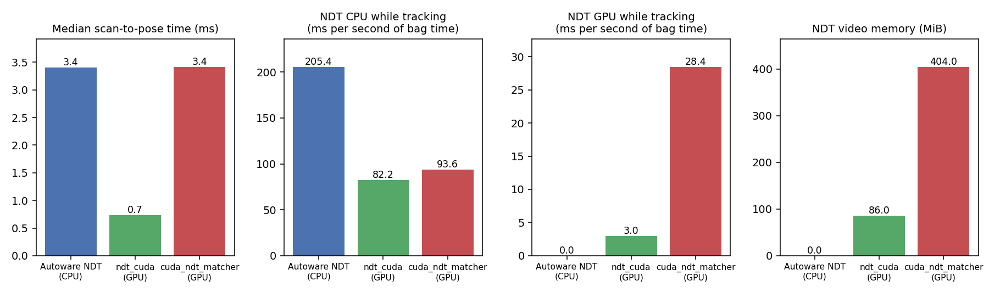
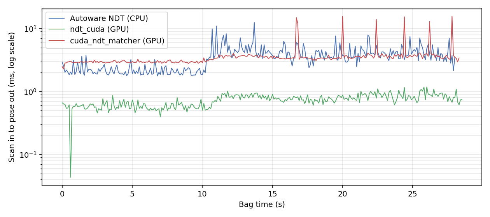
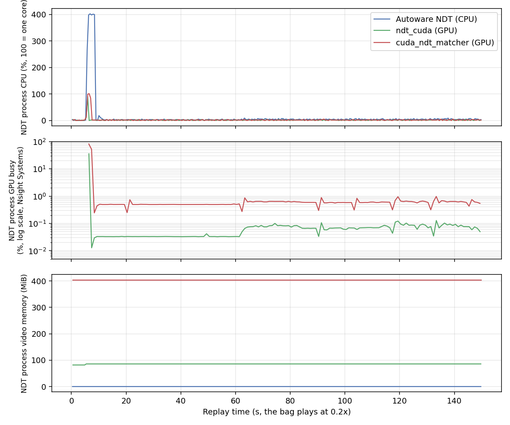

# Autoware benchmark

Measured on 2026-11-07 with ndt_cuda at commit `5f14752`; the GPU traces on 2026-11-08.

This report runs the [rosbag replay simulation](https://docs.autoware.org/main/simulation/rosbag-replay-simulation/) of Autoware 1.5.0 with three NDT scan matchers. Autoware and the replay stay the same; only the scan matcher changes.

| Name in this report | What runs |
| --- | --- |
| Autoware NDT | Autoware's own `autoware_ndt_scan_matcher`, unchanged. It uses Autoware's copy of tier4/ndt_omp on the CPU. |
| ndt_cuda | The same `autoware_ndt_scan_matcher` node, with [`integrations/autoware/apply.sh`](../integrations/autoware) applied so that it uses ndt_cuda. |
| cuda_ndt_matcher | [NEWSLabNTU/cuda_ndt_matcher](https://github.com/NEWSLabNTU/cuda_ndt_matcher) at commit `99540d8`, a separate GPU scan matcher node in Rust. It replaces the Autoware node through a launch file overlay, with the same topics and parameter file. |

In summary, on one laptop GPU and the 30 second Autoware sample bag:

- **Speed:** ndt_cuda turns a scan into a pose in 0.74 ms (median), against 3.4 ms for both Autoware NDT and cuda_ndt_matcher. Its slowest scan took 1.6 ms, against 11 ms and 23 ms.
- **Initial pose:** the search for the initial pose took 0.56 s with ndt_cuda, 1.6 s with cuda_ndt_matcher and 3.1 s with Autoware NDT.
- **Resources:** while tracking, ndt_cuda used 82 ms of CPU time per second of bag time, against 205 ms for Autoware NDT and 94 ms for cuda_ndt_matcher. It kept the GPU busy for 3.0 ms per second of bag time (0.3% of the GPU in real time), against 28 ms for cuda_ndt_matcher, and used 86 MiB of video memory, against 404 MiB.
- **Results:** all three keep localized through the whole bag. Their poses differ from Autoware NDT by a median of about 4 mm. Repeated runs of Autoware NDT itself differ by up to 50 mm, because the replay is not deterministic.



## Test setup

| Component | Value |
| --- | --- |
| GPU | NVIDIA GeForce RTX 3050 Ti Laptop GPU, 4 GB, driver 595.99.02 |
| CPU | Intel Core i7-11800H, 8 cores, 16 threads |
| Autoware | 1.5.0, Docker image `ghcr.io/autowarefoundation/autoware:universe-devel-cuda-1.5.0` (`sha256:bca6bc89…`), ROS 2 Humble, CUDA 12.4 |
| Data | Autoware's sample map (326867 points) and sample rosbag (30 s, 3 Velodyne lidars), as in the Autoware documentation |
| Replay | `ros2 bag play -r 0.2`, as in the Autoware documentation |
| NDT parameters | Autoware's defaults for all three: resolution 2 m, at most 30 iterations, transformation epsilon 0.01, no line search, 200 particles for the initial pose |
| Runs | 3 per scan matcher, interleaved, without RViz, and one more per GPU version with Nsight Systems for the GPU use |

Two changes from the documented replay keep the measurements about the scan matcher:

- **Perception, planning and control are off** (`perception:=false planning:=false control:=false`). Map loading, sensing, localization and the rest of the system run. This also avoids downloading the machine learning models and keeps their GPU work out of the measurements.
- **DDS settings** are those of the Autoware documentation ([`cyclonedds.xml`](../benchmark/autoware/cyclonedds.xml), larger IP fragment buffers). Without them, Docker's network dropped up to 60% of the scans.

## Results

All values combine the 3 runs. "Scan to pose" is the time from the scan matcher's input scan to its output pose, both seen by the same recorder. Unlike each node's `exe_time_ms`, it covers the same work for all three.

| | Autoware NDT | ndt_cuda | cuda_ndt_matcher |
| --- | --- | --- | --- |
| Poses per run | 281 | 286 | 284 |
| Scan to pose, median (ms) | 3.40 | **0.74** | 3.41 |
| Scan to pose, p95 (ms) | 6.72 | **1.02** | 4.01 |
| Scan to pose, p99 (ms) | 8.56 | **1.19** | 15.96 |
| Scan to pose, maximum (ms) | 10.98 | **1.58** | 23.04 |
| `exe_time_ms`, median (ms) | 3.13 | 0.50 | 3.23 |
| Initial pose search (s) | 3.09 | **0.56** | 1.57 |
| Iterations, mean | 2.56 | 2.53 | 2.56 |
| Transform probability, median | 5.857 | 5.877 | 5.853 |
| NVTL, median | 3.101 | 3.112 | 3.111 |
| NVTL, lowest (threshold 2.3) | 2.882 | 2.870 | 2.903 |
| CPU while tracking (ms per second of bag time) | 205 | **82** | 94 |
| CPU peak during the initial pose search (%, 100 = one core) | 403 | 97 | 101 |
| GPU while tracking (ms per second of bag time) | 0 | **3.0** | 28.4 |
| GPU time of the initial pose search (ms) | 0 | **356** | 1333 |
| Video memory (MiB) | 0 | 86 | 404 |
| Resident memory (MiB) | 68 | 229 | 448 |

The poses per run differ because ndt_cuda finds the initial pose first and so also aligns the first scans.

`exe_time_ms` does not measure the same work in all three. Autoware NDT and ndt_cuda time the whole scan callback, from the input scan to the scores. cuda_ndt_matcher times only its alignment. Only the scan to pose rows compare the three.

### Time per scan

ndt_cuda is the fastest on every scan. The steps at about 10 s are where the vehicle starts moving and the scans change. cuda_ndt_matcher has regular spikes of about 15–23 ms.



### CPU and GPU use

The figure shows the first run of each for CPU and video memory, and the traced run for the GPU. The peak at the start is the initial pose search. Autoware NDT uses its 4 threads there; the GPU versions use the GPU. While tracking, the scan matcher uses little CPU and GPU in all three because the bag plays at 0.2x: scans arrive at 2 Hz instead of 10 Hz. The table therefore gives the CPU and GPU time per second of bag time, which is what a real-time run needs.



The GPU use is the time the GPU spent on the kernels and copies of the scan matcher process, from a [Nsight Systems](https://developer.nvidia.com/nsight-systems) trace ([`gpu_trace.py`](../benchmark/autoware/gpu_trace.py)), averaged over 1 s. `nvidia-smi` reports whole percents and shows both GPU versions as 0 while tracking. While tracking, ndt_cuda keeps the GPU busy for about 0.3 ms per scan, which in real time is 0.3% of the GPU; cuda_ndt_matcher needs about 2.8 ms per scan, 2.8%. The step of ndt_cuda at about 60 s is where the vehicle starts moving.

The trace adds a little to the time per scan: the median scan-to-pose time of the traced runs was 0.78 ms for ndt_cuda and 3.53 ms for cuda_ndt_matcher, against 0.74 ms and 3.41 ms without the trace. The other values in the table come from the runs without the trace.

### Agreement with Autoware NDT

The sample bag has no ground truth, so these values measure agreement with Autoware NDT, not accuracy. Poses are matched by scan time to the first run of Autoware NDT.

| Run | Median (mm) | p95 (mm) | Maximum (mm) | Largest heading difference (°) |
| --- | --- | --- | --- | --- |
| Autoware NDT, runs 2 and 3 | 0.1–0.3 | 20.4–20.6 | 33.4–50.0 | 0.046 |
| ndt_cuda, runs 1–3 | 4.0 | 22.0–24.8 | 37.0–53.2 | 0.040 |
| cuda_ndt_matcher, runs 1–3 | 4.2–7.8 | 21.2–23.8 | 42.1–49.4 | 0.069 |

The largest differences are of the same size as those between runs of Autoware NDT itself. The replay is not deterministic: small timing differences change the initial guesses of the EKF. The median difference of about 4 mm is systematic: the GPU versions compute in single precision, and ndt_cuda also corrects the sign of one hessian term (see the [README](../README.md#differences-from-ndt_omp)).

## Notes on the comparison

- **Hardware:** only one laptop GPU was tested. cuda_ndt_matcher reports its own results on an RTX 5090 and a Jetson AGX Orin, which this report does not repeat.
- **Data:** the sample bag is short and its map small. Larger maps load in tiles while driving, which this bag barely exercises.
- **cuda_ndt_matcher setup:** it runs with Autoware's parameter file and Autoware's point cloud preprocessing, not with the launch files and the preprocessing settings of its own repository. Its line search is off, as in Autoware. It needs a few more packages than the Autoware image has ([`cuda_ndt_matcher.Dockerfile`](../benchmark/autoware/docker/cuda_ndt_matcher.Dockerfile)).
- **Covariance formula:** Autoware's copy of the voxel grid computes the covariance differently from tier4/ndt_omp. With the formula of tier4/ndt_omp, ndt_cuda gave 3–7% lower scores in Autoware. The integration enables Autoware's formula (`setUseAutowareCovariance(true)`).

## Reproducing

The scripts are in [`benchmark/autoware`](../benchmark/autoware). They expect the Autoware image, the sample data under `~/projects/autoware_data` and a workspace with ndt_cuda and the patched `autoware_ndt_scan_matcher` under `~/projects/autoware_ws` (see [`integrations/autoware`](../integrations/autoware)).

```bash
bash benchmark/autoware/run_benchmark.sh builtin run1        # Autoware NDT
bash benchmark/autoware/run_benchmark.sh ndt_cuda run1       # ndt_cuda
bash benchmark/autoware/run_benchmark.sh cuda_ndt_matcher run1
GPU_TRACE=1 bash benchmark/autoware/run_benchmark.sh ndt_cuda trace          # GPU use, with Nsight Systems
GPU_TRACE=1 bash benchmark/autoware/run_benchmark.sh cuda_ndt_matcher trace
python3 benchmark/autoware/make_report.py ~/projects/autoware_bench/results docs/images/autoware run1,run2,run3
```

`GPU_TRACE=1` mounts Nsight Systems of the host (`NSYS_DIR`, by default `/opt/nvidia/nsight-systems/2024.6.2`) into the container, as the Autoware image does not have it.

`record_demo.sh` records a run with RViz on a virtual screen and then writes the CPU, GPU and video memory use of the scan matcher into a corner ([`make_video.py`](../benchmark/autoware/make_video.py)). It replays the bag in real time (`RATE=1.0`), so the corner shows the use of a real run; the GPU column comes from a Nsight Systems trace and is the busy share of the last second. The trace takes some video memory in the traced process, so the videos show about 30 MiB more than the table. RViz renders on the CPU there, so its runs are only for viewing, not for measurements.
